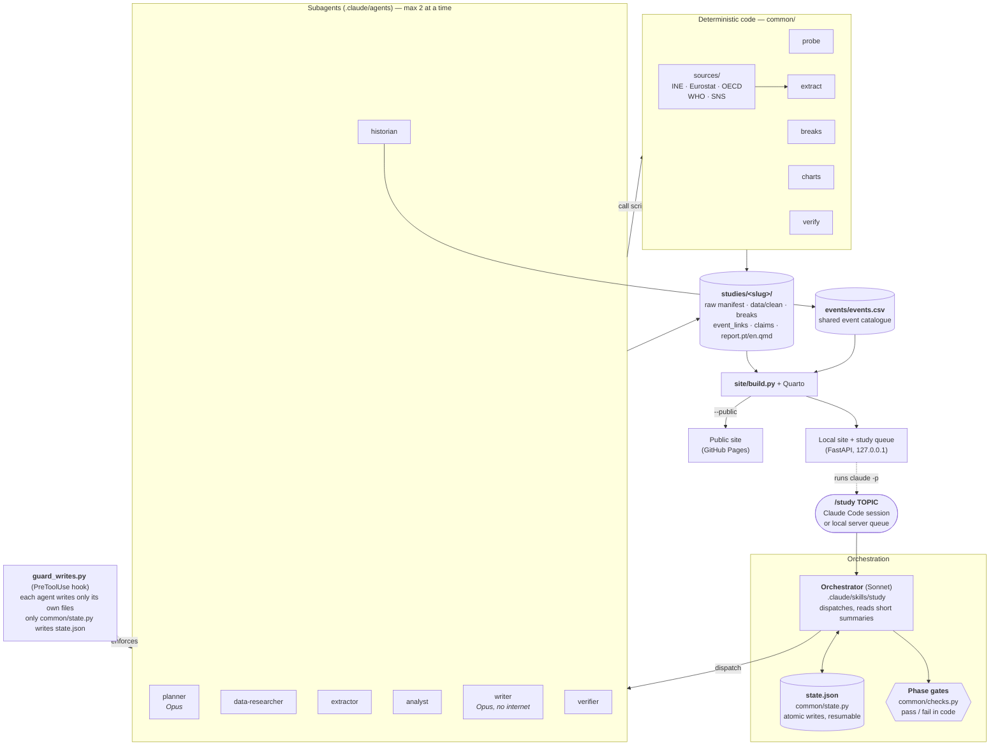

# studies_center

A local platform that produces and publishes **exhaustive, data-driven studies about Portugal**.
Each study starts from one command (`/study <topic>`) and adds a bilingual (PT/EN) page to a
static Quarto site, where every number carries a source, an excerpt and an access date.

Seven specialised Claude Code subagents run through eight phases. Each phase is gated by **code,
not by the model's judgement**, and all progress lives on disk, so a run that is cut off (for
example by the plan's token limit) resumes exactly where it stopped.

- **Public site:** published with GitHub Pages (see [Publishing](#publishing))
- **Languages:** code, file names and technical identifiers are in English; the study reports and
  their working documents (`plan.md`, `progress.md`, `pending.md`, `verification.md`) are in
  Portuguese, with an English version of each report.

## Contents

1. [Principles](#principles)
2. [Architecture](#architecture)
3. [Stack](#stack)
4. [Orchestration: the `/study` flow](#orchestration-the-study-flow)
5. [Agents](#agents)
6. [State, resuming and limits](#state-resuming-and-limits)
7. [Data model](#data-model)
8. [Repository layout](#repository-layout)
9. [Setup and usage](#setup-and-usage)
10. [Local server and queue](#local-server-and-queue)
11. [Publishing](#publishing)
12. [Tests](#tests)
13. [Security and privacy](#security-and-privacy)
14. [Licences and data attribution](#licences-and-data-attribution)
15. [Known limitations](#known-limitations)
16. [Improvement ideas](#improvement-ideas)

## Principles

These can never be broken (details in [`CLAUDE.md`](CLAUDE.md)):

1. **No claim without a source.** Every number, fact or event has a row in
   `studies/<slug>/claims.csv` (URL, access date, an excerpt of fewer than 15 words).
2. **Primary sources first.** INE, Eurostat, OECD, WHO, DGS, SNS; Diário da República,
   parlamento.pt, EUR-Lex, CNE. News is context only and is tagged `source_nature = news`.
3. **Coincidence is not causation.** Grade A (a source states the cause) → "contributed to";
   B (a documented, plausible mechanism) → "may have contributed to"; C (only a coincidence in
   time) → "coincided with".
4. **Independent verification.** The `writer` never verifies. The `verifier` opens every URL and
   confirms excerpt, date and value, and never edits the report.
5. **Copyright.** Always paraphrase; at most one short, attributed literal quote per source.
6. **Reproducibility.** Every chart is generated by code from data committed in `data/clean/`.

## Architecture

### System components



### Phase and data flow

```mermaid
flowchart LR
    p1["1 · Plan<br/><b>plan.md</b>"] --> p2["2 · Sources<br/><b>sources.csv</b>"]
    p2 --> p3["3 · Extraction<br/><b>raw_manifest.csv</b><br/><b>data/clean/*.parquet</b>"]
    p3 --> p4["4 · Analysis<br/><b>breaks.csv</b><br/>chart JSON"]
    p4 --> p5["5 · Events<br/><b>event_links.csv</b><br/>grade A / B / C"]
    p5 --> p6["6 · Writing<br/><b>report.pt/en.qmd</b><br/><b>claims.csv</b>"]
    p6 --> p7["7 · Verification<br/><b>verification.md</b>"]
    p7 -- "unconfirmed claims<br/>(max 3 rounds, then removed)" --> p6
    p7 --> p8["8 · Publication<br/>status: published"]
    p8 --> site["Site build<br/>+ optional push"]
```



Key ideas:

- **The LLM decides little; code decides almost everything.** Source probing, extraction,
  normalisation, break detection, excerpt verification and every phase-completion condition are
  Python scripts. Agents describe *what* to do (JSON specs, analysis scripts, prose).
- **State on disk, not in the conversation.** Progress lives in `state.json`, in each phase's
  files and in one commit per phase, so a cut-off run loses at most one unit of work.
- **Per-agent permissions enforced by a hook.** `.claude/hooks/guard_writes.py` blocks a subagent
  from writing outside its allow-list (table below) or touching `state.json`.
- **Shared event catalogue.** `events/events.csv` is common to all studies.

## Stack

| Layer | Technology |
| --- | --- |
| Orchestration | [Claude Code](https://claude.com/claude-code) (skills, subagents, hooks); headless `claude -p` from the server |
| Data and analysis | Python ≥ 3.12, pandas, pyarrow (Parquet), numpy, scipy, statsmodels, [ruptures](https://github.com/deepcharles/ruptures) (change points) |
| Sources | `sdmx1` (Eurostat, OECD), INE JSON API, WHO OData API, SNS exports, httpx, pypdf, BeautifulSoup, rapidfuzz |
| Validation | pydantic (schemas for every tracked CSV) |
| Site | [Quarto](https://quarto.org) bilingual website, OJS + Plotly interactive charts |
| Local server | FastAPI, uvicorn, Server-Sent Events (sse-starlette) |
| Project tooling | `uv` (dependencies and environment), pytest, ruff |
| CI/CD | GitHub Actions + GitHub Pages |

## Orchestration: the `/study` flow

Defined in [`.claude/skills/study/SKILL.md`](.claude/skills/study/SKILL.md). Eight phases, in
order. The orchestrator only moves on when the phase condition passes **in code**
(`uv run python -m common.state complete-phase <slug> <phase>`, which runs `common.checks`).

| # | Phase | Agent | Unit of work | Main output |
| --- | --- | --- | --- | --- |
| 1 | Plan | `planner` | — | `plan.md` |
| 2 | Sources | `data-researcher` | an axis (or axes from the same provider) | `sources.d/*.csv` → `sources.csv` |
| 3 | Extraction | `extractor` | a tested source | `data/extract/<id>.json`, `data/clean/*.parquet`, `data/raw_manifest.csv` |
| 4 | Analysis | `analyst` | — | `analysis/*.py`, `analysis/out/*.json`, `breaks.csv` |
| 5 | Events | `historian` | — | `events/events.csv`, `event_links.csv` (with grade A/B/C) |
| 6 | Writing | `writer` | language (`pt`, then `en`) | `report.pt.qmd`, `report.en.qmd`, `claims.csv` |
| 7 | Verification | script + `verifier` | claim | `verification.md`, `verification_status` in `claims.csv` |
| 8 | Publication | script | — | `status: published` + site build |

Orchestration rules:

- One `common.state init|resume|start-phase|plan-units|unit-start|unit-done|complete-phase`
  command per step; `unit-done` refuses missing or invalid outputs.
- At most **2 subagents at a time**; subagent summaries are ≤150 words; the orchestrator passes
  *paths*, not contents.
- **Hard-to-reverse decisions** (dropping an axis, changing the scope, publishing an unclear
  grade A) are never taken by an agent: it writes `pending.md` and stops, and the answer is
  stored in `decisions.md` (the local Queue page shows the options as buttons).
- **At most 3 attempts per phase**, counted in `state.json`; on the third the phase becomes
  `blocked` and the impasse goes to `pending.md`.
- One commit per completed phase: `fase <n> (<name>): <slug>`.

### Verification (phase 7)

1. `common.verify --apply` confirms mechanically what it can: it fuzzy-searches the recorded
   excerpt in the normalised page/PDF text and recomputes the value from `data/clean/`.
2. Only the still-unconfirmed claims go to the `verifier`, in batches of up to 15, for manual
   checking.
3. Whatever remains unconfirmed goes back to the `writer`, up to 3 rounds; if it still cannot be
   confirmed the claim is **removed**, never left without a verified source.

## Agents

Defined in [`.claude/agents/`](.claude/agents). The hook enforces the "Writes to" column.

| Agent | Model | Tools | Writes to |
| --- | --- | --- | --- |
| `planner` | Opus | Read, Write, Edit, Glob, WebSearch, WebFetch | `plan.md` |
| `data-researcher` | Sonnet | Read, Write, Edit, WebSearch, WebFetch, Bash | `sources.d/<unit>.csv` |
| `extractor` | Sonnet | Read, Write, Edit, Bash | `data/raw/`, `data/extract/`, `data/clean/*.parquet`, `raw_manifest.csv` |
| `analyst` | Sonnet | Read, Write, Edit, Glob, Bash | `analysis/**`, `breaks.csv` |
| `historian` | Sonnet | Read, Write, Edit, WebSearch, WebFetch | `events/events.csv`, `event_links.csv` |
| `writer` | Opus | Read, Write, Edit, Glob, Grep (**no internet**, on purpose) | `report.{pt,en}.qmd`, `claims.csv`, `study.yml` |
| `verifier` | Sonnet | Read, Glob, Grep, WebFetch, Bash, Write | `verification.md`; only the `verification_status` column of `claims.csv` |

## State, resuming and limits

- `studies/<slug>/state.json` (schema v2): current phase, completed phases, attempts and
  per-unit progress. Only `common/state.py` writes it, atomically (temp file + `os.replace`);
  subagents cannot.
- `/study <topic>` always starts with `common.state resume <slug>` and continues where it
  stopped; the unit that was in flight is redone from scratch.
- Tokens are limited: when the plan's usage limit cuts a run, the server marks the queue item
  `interrupted` with the renewal time, and the study resumes from `state.json` when it is run
  again.
- Token usage and cost per phase and model are written to `studies/<slug>/usage.csv`
  (internal; **never** shown on the public site).

## Data model

Long format in `studies/<slug>/data/clean/*.parquet`, one observation per row:

`date, region, sex, age, indicator, value, unit, source_id`

Tracked CSV files (pydantic schemas in `common/schemas.py`):

| File | Content |
| --- | --- |
| `sources.csv` | Source catalogue: URL, provider, licence, coverage, test status |
| `data/raw_manifest.csv` | url, file, download_date, sha256, bytes (the raw files themselves are not in git) |
| `breaks.csv` | Detected breaks: level shift, slope change or spike |
| `event_links.csv` | Break ↔ event, with an A/B/C evidence grade |
| `claims.csv` | Each claim: URL, access date, excerpt, value, calculation, verification status |
| `events/events.csv` | Shared event catalogue (primary source, scope, theme) |

## Repository layout

```
.claude/             agents, the /study skill, guard_writes.py hook, settings.json
common/              deterministic pipeline (state, checks, probe, extract, breaks, verify, charts, usage)
common/sources/      INE, Eurostat, OECD, WHO and SNS clients
events/              shared event catalogue and event-source notes
studies/<slug>/      one study (plan, sources, clean data, analysis, reports, claims)
site/                Quarto project (pt/en), build.py, assets
server/              local FastAPI app: study queue, live progress, optional auto-publish
tests/               pytest
.github/workflows/   Pages and tests
```

## Setup and usage

Requirements: [uv](https://docs.astral.sh/uv/), [Quarto](https://quarto.org/docs/get-started/)
(≥ 1.6) and, to generate new studies, an authenticated
[Claude Code](https://claude.com/claude-code).

```bash
uv sync                                  # environment and dependencies
PYTHONPATH=. uv run pytest -q            # tests (inside Claude Code, PYTHONPATH is already set)
```

Generate a study (in a Claude Code session, preferably with `/model sonnet`):

```
/study State of health in Portugal
```

Useful commands:

```bash
uv run python -m common.state resume <slug>          # where the study stands
uv run python -m common.checks <slug> <phase>         # a phase's condition, in code
uv run python -m common.probe eurostat:DEMO_MLEXPEC   # test a source
uv run python -m common.verify studies/<slug> --apply # mechanical claim verification
uv run python -m common.usage [<slug>]                # tokens and cost
uv run python site/build.py                           # full local site (includes the Queue)
```

To recreate a study's `data/raw/` (it is not in git), use `common/download.py` with its
`data/raw_manifest.csv`; the SHA-256 detects sources that changed since the download.

## Local server and queue

```bash
uv run python -m server.app        # http://127.0.0.1:8765  (localhost only)
```

It serves the compiled site and an API for the **study queue**: add topics, choose which one
runs (one at a time), follow per-phase progress live, answer pending decisions and see the cost.
The server launches `claude -p` with an argument list (never a shell string) and validates the
topic against a strict character set. `queue.json` and `logs/` are local and git-ignored.

## Publishing

The public site is a **read-only** build:

```bash
uv run python site/build.py --public      # writes site/_site_public/
```

Compared with the local build: only studies with `status: published`, no Queue page or
`queue.js`, no costs or progress. The Events page is kept. Test (`status: test`) and in-progress
(`in_progress`) studies never appear. To preview a test study: `--include-status test`.

The [`pages.yml`](.github/workflows/pages.yml) workflow builds and deploys on every push to `main`
that touches studies, events, the site or the dependencies. To enable it: **Settings → Pages →
Source: GitHub Actions**. Paths work both at a domain root and under `/<repo>/` (Quarto turns
absolute links into relative ones and `lang-switch.js` reads any hosting prefix from the URL).

Publishing a study = phase 8 of `/study` (`status: published` in `study.yml`) + a push.

**Optional auto-push.** If the local server is started with `STUDIES_AUTO_PUSH=1`, at the end of
a run that published a study the server (`server/publish.py`) commits whatever is left and runs
`git push origin main`, which triggers the Pages workflow. The push is done by the server and
never by an agent (`git push` stays denied in `.claude/settings.json`). It only runs if the study
is `published` with phase 8 completed, the branch is `main`, the remote exists
(`STUDIES_PUSH_REMOTE`, default `origin`) and there are no other uncommitted changes. The result
appears in the item's note on the Queue page. Off by default.

```bash
STUDIES_AUTO_PUSH=1 uv run python -m server.app
```

## Tests

`tests/` covers state and resuming, phase checks, extraction, normalisation, schemas, the write
guard hook, the site build, claim verification, resilience to source failures (INE) and the
server (queue and auto-push). They run in CI ([`tests.yml`](.github/workflows/tests.yml)). There
are no quality tests for the *agents* themselves; see [Improvement ideas](#improvement-ideas).

## Security and privacy

- No secrets in the repository: there are no API keys (authentication is Claude Code's own).
- `queue.json`, `logs/` and `data/raw/` are not versioned.
- The Queue page only shows the plan type (never the email or organisation) and is not published.
- The server listens on `127.0.0.1` only.
- `.claude/settings.json` denies `rm`, `git push`, `git reset`, `curl` and `sudo` to the agent.
- Subagents only write to their own files (`guard_writes.py` hook).
- Commits use the GitHub `noreply` address and carry no co-author trailer.

## Licences and data attribution

The clean data derives from official sources (INE, Eurostat, OECD, WHO, SNS…), each with its
licence recorded in `sources.csv`. The site only exports for download (`open_data.csv`) the
sources whose licence is **not** non-commercial. Always cite the original source. The licence of
the code and texts in this repository is still to be defined (add a `LICENSE` file).

## Known limitations

- Portugal only; coverage is limited by what each provider publishes in an accessible form.
- SNS Transparência has no stable API: it depends on exports found case by case.
- Break detection produces *candidates*; linking to events needs a source (grade A) or stays a
  coincidence (grade C).
- Text-matching verification fails on dynamic (JavaScript) pages and scanned PDFs; those claims
  fall to manual verification.
- Interactive sessions do not record usage; only runs launched by the server do.

## Improvement ideas

In order of impact on robustness:

1. **Evals for the agents.** Today only the deterministic code is tested. Add an `evals/` folder
   with frozen fixtures (one commit per phase is a ready-made starting point) and code graders:
   inject errors into an already-verified report to measure the `verifier`'s recall and false
   positives; "coincidence only" cases the `historian` must grade C; numbers outside
   `claims.csv` that the `writer` must not write. Run each case 3×, and compare before/after any
   prompt or model change.
2. **Orchestrator in code.** Move the phase loop out of the prompt into a Python script (for
   example with the Claude Agent SDK) while keeping agents and hooks. It takes the LLM out of the
   coordinator role, cuts tokens and makes resuming fully deterministic.
3. **Freeze the sources.** Raw files are outside git and INE/Eurostat revise series. Keep
   snapshots (for example as release assets or in a bucket) with the manifest's SHA-256 and
   record each series' vintage date, so an old report stays verifiable.
4. **Stronger verification.** Archive the page used (Wayback Machine or a local copy of the
   excerpt) to survive link rot; periodically re-verify the URLs of published studies and raise
   an alert when something changes.
5. **Enforce "no number without a mark".** Make `common.checks` blocking in CI for `published`
   studies (numbers without `{.claim}`, evidence grades consistent with the wording, PT/EN
   parity, quotes under 15 words) and run the mechanical verification in the publishing
   pipeline too.
6. **Enforce the `verifier`'s restriction in code.** The hook only filters by path; limiting it
   to one column of `claims.csv` currently depends on the prompt. Validate by diff (only
   `verification_status` changed) before accepting the write.
7. **Environment quality and reproducibility.** Fix the outstanding `ruff` warnings (some in
   `tests/`) and make lint blocking in CI; pin the Quarto version and the actions by SHA; add
   `pre-commit`.
8. **History hygiene.** Keep the GitHub `noreply` email and review the history before every
   major publication; keep `usage.csv` out of the public repository if cost is considered
   sensitive.
9. **Observability.** A per-agent metrics view (attempts, failure rate per phase, cost per
   quality point) fed by `usage.csv` and `state.json`, to choose each agent's model with data.
10. **Reading experience.** A public methodology page (evidence grades, how claims are
    verified), a per-study revision log (version and date), RSS, and Open Graph metadata for
    sharing.
11. **Clean-up.** `prompt_claude_code_estudos.md` is the original bootstrap prompt, with old
    names (`/estudo`); move it to `docs/` or remove it. `scripts/migrate_v1_names.py` is a
    one-off migration that has already been applied.
12. **Licence.** Choose and add a `LICENSE` (for example MIT for code and CC BY 4.0 for texts),
    respecting the licences of the underlying data.
